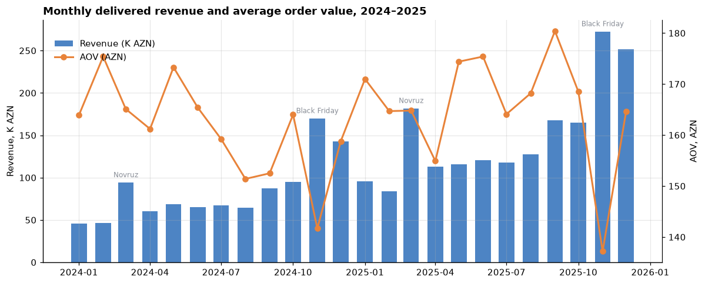
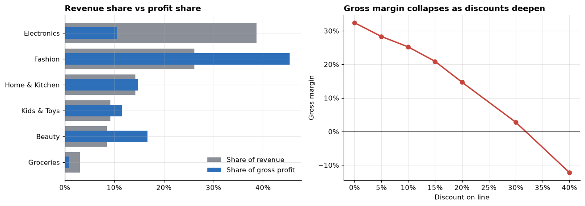
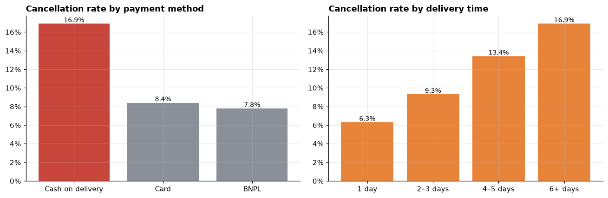
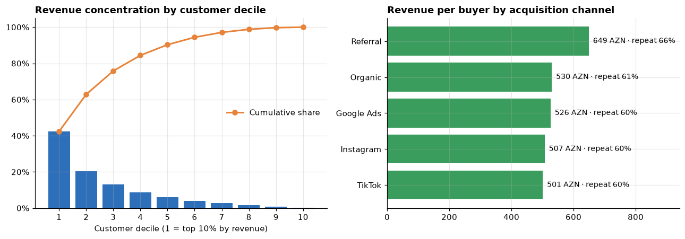

# 🛒 E-commerce Sales Analysis with SQL — Azerbaijani Online Store

> **Daily Data Analytics Project · Day 02**

Two years of orders (2024–2025) from an online retailer that sells in 8 Azerbaijani cities. All of the analysis is written in **SQL (SQLite)**: CTEs, window functions and `CASE` logic. The goal is to find where the business actually makes money and where it loses it.

## 🎯 Business question
1. How are revenue, orders and AOV trending, and how strong is seasonality (Novruz, Black Friday, New Year)?
2. Which categories make the **profit**, not just the revenue, and what do discounts do to margin?
3. Why are orders cancelled, and how much revenue does that cost?
4. How much does the business depend on its best customers, and do customers come back?

## 📊 Key results (delivered orders)

| KPI | Value |
|---|---|
| Delivered orders | 17,535 |
| Buyers | 5,328 |
| Net revenue | **2,820,945 AZN** |
| Gross profit · margin | 751,531 AZN · **26.6%** |
| Average order value | 160.9 AZN |
| Revenue growth 2024 → 2025 | **+79.9%** (1.01M → 1.81M AZN) |
| Cancellation rate · revenue lost | 11.3% · **355,437 AZN** |
| Repeat-purchase rate | 60.8% (3.3 orders per buyer) |
| Top 10% of buyers' share of revenue | **42.3%** |



**Seasonality:** November (Black Friday) is the largest month in both years, and Novruz week roughly doubles March. AOV *drops* in Black Friday months. Customers buy more items, but at deeper discounts.

### Profit ≠ revenue
| Category | Revenue share | Profit share | Gross margin |
|---|---|---|---|
| Electronics | **38.7%** | 10.6% | 7.3% |
| Fashion | 26.2% | **45.4%** | 46.2% |
| Home & Kitchen | 14.3% | 14.8% | 27.6% |
| Kids & Toys | 9.2% | 11.6% | 33.6% |
| Beauty | 8.5% | 16.7% | **52.3%** |
| Groceries | 3.1% | 0.9% | 8.0% |

Margin falls from **32.4%** at full price to **2.8%** at a 30% discount and **−12.2%** at 40%.



### Cancellations
| Driver | Cancellation rate |
|---|---|
| Cash on delivery vs Card vs BNPL | **16.9%** vs 8.4% vs 7.8% |
| Delivery 1 day → 6+ days | 6.3% → **16.9%** |
| Baku vs Sheki / Lankaran | 8.9% vs 17.7% / 16.7% |



### Customers
The top decile of buyers averages 9.3 orders and brings in 42.3% of revenue, and the top 30% bring in 75.8%. Referral customers are the most valuable (649 AZN per buyer, 66% repeat rate). The average gap between the 1st and 2nd order is 131 days.



## 💡 Recommendations
| Area | Recommendation |
|---|---|
| Seasonality | Plan stock, couriers and ad budget 6–8 weeks before Novruz, Black Friday and New Year |
| Profit mix | Put promo budget into high-margin Fashion & Beauty; treat Electronics as a traffic driver rather than a discount target |
| Discounts | Cap discounts at 20% outside Black Friday; keep low-margin Electronics and Groceries out of deep promos |
| Cash on delivery | Offer a small incentive for card payment, or a prepaid deposit on large COD orders |
| Regional delivery | Add pickup points or partner couriers in Sheki, Lankaran and Ganja to cut delivery time |
| Loyalty | Start a VIP tier for the top decile, plus a 2nd-order coupon before day ~130; scale the referral programme |

## 🧠 SQL techniques used
- Data cleaning in a view: `SELECT DISTINCT` de-duplication and median imputation with `ROW_NUMBER()` + `COUNT() OVER`
- Multi-table joins into a line-level `sales` view (net revenue and gross profit)
- `LAG()` for month-over-month and year-over-year growth; running YTD totals with `SUM() OVER (PARTITION BY … ORDER BY …)`
- `RANK() OVER (PARTITION BY category)` for top products per category
- `NTILE(10)` customer deciles and cumulative revenue share (Pareto)
- `julianday()` + `LAG()` for days between orders
- Conditional aggregation (`AVG(status = 'Cancelled')`, `CASE WHEN`) for rates

## 🛠 Tech stack
SQL (SQLite) · Python · pandas · matplotlib · Jupyter

## 📁 Structure
```
├── sales_analysis.ipynb     # full SQL analysis (data quality → KPIs → trends → findings)
├── build_notebook.py        # builds the notebook with nbformat
├── data/
│   ├── generate_data.py     # reproducible synthetic data generator (seed = 7)
│   └── ecommerce.db         # SQLite: customers, products, orders_raw, order_items
├── images/                  # exported charts
└── requirements.txt
```

**Schema:** `customers` (6,000) · `products` (250) · `orders_raw` (20,972, including 25 duplicates and 40 missing values) · `order_items` (35,640)

## ▶️ Run it
```bash
pip install -r requirements.txt
python data/generate_data.py   # optional: regenerate the database
jupyter notebook sales_analysis.ipynb
```

> ℹ️ The dataset is **synthetic**: generated with a fixed seed and modelled on typical e-commerce patterns. City names are real, but no real company or customer data is used.

---

### 🇦🇿 Azərbaycanca xülasə
Azərbaycanın 8 şəhərində satış edən onlayn mağazanın 2024–2025 sifarişləri tamamilə **SQL (SQLite)** ilə analiz edilib. Gəlir bir ildə **+79.9%** artıb (2.82M AZN). Ən böyük pik Black Friday və Novruz dövrləridir. **Elektronika** gəlirin 38.7%-ni gətirir, amma mənfəətin cəmi 10.6%-ni verir. Əsas mənfəət mənbəyi **Geyim** (45.4%) və **Kosmetika**dır. 30%+ endirimdə marja demək olar ki, sıfıra düşür. **Qapıda nağd ödəniş** sifarişləri kartla ödənişə nisbətən iki dəfə çox ləğv olunur (16.9% vs 8.4%). Çatdırılma 6 gündən çox çəkəndə ləğv 16.9%-ə çatır, ləğvlər ümumilikdə 355K AZN itki deməkdir. Müştərilərin ən yaxşı 10%-i gəlirin 42.3%-ni gətirir.
